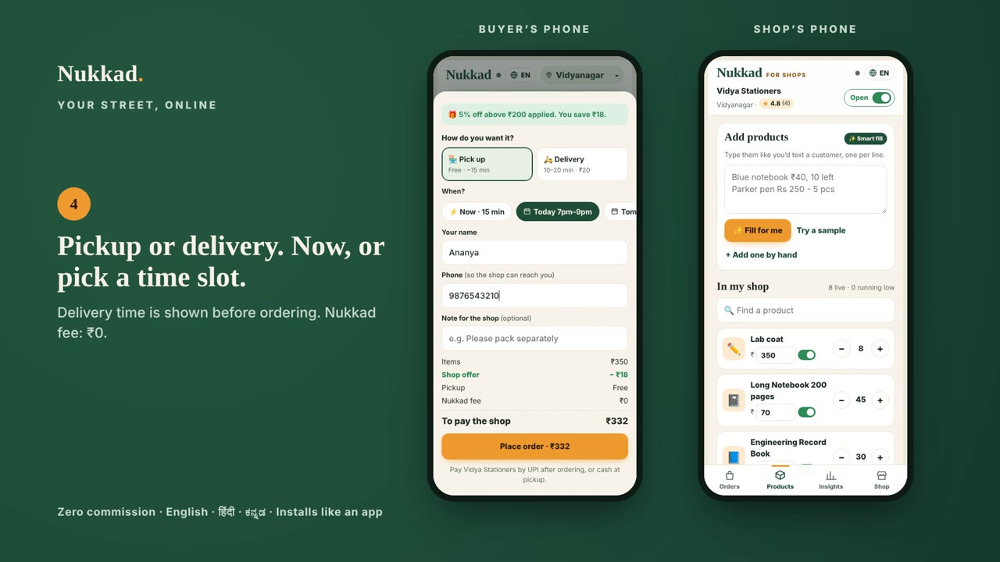

# Nukkad — shops on your street, on your phone



**Team Nukkad** · KLE Tech CodeFest 2026 · Domain 1: Full-Stack Web Applications × E-Commerce
Daniel C Acharya (01FE25BCA281) · Vinuta Yalagi (01FE25BCA284) · A S Sanika (01FE24BCA082)

Two installable apps that share one backend:

| App | Who uses it | Address | Installs as |
|---|---|---|---|
| **Nukkad** | Customers | `/` | "Nukkad" (forest green icon) |
| **Nukkad for Shops** | Shopkeepers | `/seller/` | "Nukkad Shops" (marigold icon) |

Both are Progressive Web Apps: open the link on an Android phone, tap **Install**, and they sit on the home screen and open full screen like any Play Store app. On iPhone: Share → Add to Home Screen.

## What's inside

**Customer app**
- Search every shop on your street at once, in English, हिंदी or ಕನ್ನಡ (type or speak — "कलम", "ಪೆನ್", "pen" all find pens)
- Voice search (mic button, uses the phone's own speech engine)
- Recommended for you: based on your past orders, saved shops and what's popular nearby
- Shop ratings ★ and reviews from real orders
- Pickup or delivery, **now** or a **scheduled 2-hour slot**, with the shop's delivery time shown up front ("20–30 min")
- Shop offers (small, paid by the shop) applied automatically, plus "add ₹X more" nudges
- Pay the shop directly: one-tap UPI (GPay / PhonePe / Paytm), a QR for paying from another phone, or cash
- Live order tracking, rate after pickup, re-order in one tap

**Shop app**
- 4-digit PIN login, register a new shop in two minutes
- Orders arrive live with a chime and a phone notification; accept → ready → done
- Scheduled orders show their time slot; "Mark paid" when UPI money lands
- **Smart fill**: type products like a WhatsApp message ("Blue notebook ₹40, 10 left") and AI turns them into listings
- **Demand Radar**: what people near you searched for and couldn't find
- Insights: 7-day sales chart, top sellers, low stock, ratings
- Offers with guardrails: 5 / 10 / 15 % only, max ₹100 off, or free delivery above a minimum
- Printable **QR poster** for the shop counter: customers scan and land on your shop
- Open / Closed switch, delivery time, delivery fee, UPI ID

Zero commission. Nukkad never touches the money.

## Demo video
A 60-second walkthrough of both apps: `docs/nukkad-demo.mp4`.

## Run it on your laptop (2 minutes, no setup)

```bash
cd nukkad-pwa
python3 -m http.server 8080
```
Open http://localhost:8080 (customer) and http://localhost:8080/seller/ (shop) in two tabs.
Without Supabase it runs as a **demo copy** in the browser: orders placed in one tab show up in the other.
Demo PIN for every seeded shop: **1234**.
The demo opens on **Vidyanagar, Hubballi** (near KLE Tech). Pick another area from the top bar to see the Bangalore shops.

## Make it live (real phones talking to each other) — free

### 1. Database: Supabase (free plan)
1. Create a project at https://supabase.com → New project.
2. **SQL Editor** → paste `supabase/schema.sql` → Run. Then paste `supabase/seed.sql` → Run.
3. **Project Settings → API**: copy the *Project URL* and the *anon public* key.
4. Put them in `config.js`:
   ```js
   window.NK_CONFIG = { supabaseUrl: 'https://xxxx.supabase.co', supabaseKey: 'eyJ...', publicUrl: 'https://your-app.vercel.app/' };
   ```

### 2. AI for Smart fill (optional, free key)
1. Get a Gemini API key at https://aistudio.google.com/apikey
2. With the Supabase CLI:
   ```bash
   supabase login
   supabase link --project-ref <your-project-ref>
   supabase secrets set GEMINI_API_KEY=<your key>
   supabase functions deploy smart-fill --no-verify-jwt
   ```
   The key lives on the server, never inside the app. Without it, Smart fill still works using the built-in reader.

### 3. Hosting: Vercel (free)
- Push this folder to GitHub → https://vercel.com/new → import the repo → Framework preset **Other** → Deploy.
- Or drag the folder onto https://app.netlify.com/drop.
You get an `https://` link. Open it on your phone and tap **Install**. Share `/seller/` with shopkeepers.

## How it's built

```
index.html            customer app shell
seller/index.html     shop app shell
assets/app.js         both apps (built from src/)
assets/app.css        design system (Light Forest palette, light + dark)
assets/qrcode.min.js  QR codes (MIT, bundled so it works offline)
config.js             your Supabase keys
sw.js                 offline cache, fast start
manifest.webmanifest  install info (customer); seller/manifest.webmanifest (shop)
icons/                app icons
src/                  source, one file per part (data, search, customer UI, seller UI, languages…)
tools/build.py        joins src/ into assets/app.js and writes the HTML shells
tools/i18n.tsv        every sentence in English | हिंदी | ಕನ್ನಡ
tools/make-seed.js    writes supabase/seed.sql from the demo data
supabase/             schema.sql, seed.sql, functions/smart-fill
```

| Layer | Tech |
|---|---|
| Frontend | HTML, CSS, vanilla JavaScript (no framework), PWA (manifest + service worker) |
| Backend | Supabase: Postgres + Row Level Security + Realtime + Edge Functions |
| Business logic in the DB | `nk_place_order` (checks and reduces stock in one locked step, so two buyers can't buy the last piece), `nk_login` / `nk_set_pin` (PINs stored hashed with bcrypt, never readable by the app), `nk_patch` |
| AI | Gemini (via Edge Function) for Smart fill; regex fallback when offline |
| Payments | UPI deep links (`upi://pay`) straight to the shop's UPI ID |
| Languages | English, Hindi, Kannada for every screen + voice search in all three |

Change something in `src/` or `tools/i18n.tsv`, then run `python3 tools/build.py`.

## Honest notes (say these if a judge asks)
- **Security is demo grade.** Anyone with the app can read and write orders. For production, shops sign in with Supabase Auth (phone OTP) and the database rules limit each shop to its own orders and products. PINs are already hashed and hidden.
- Demo UPI IDs end in `@nukkad`, so they can't receive real money. A shop puts its real UPI ID in Shop → Orders, delivery and payment.
- Delivery is done by the shop's own staff. Nukkad shows the time window, it doesn't run riders.
